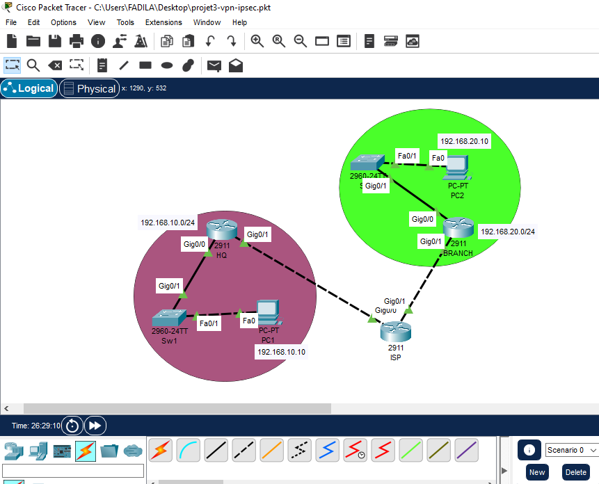
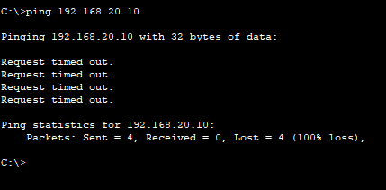
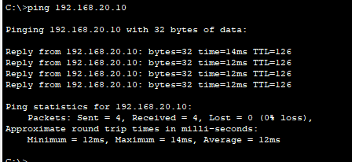
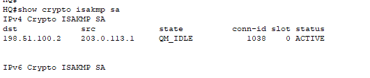
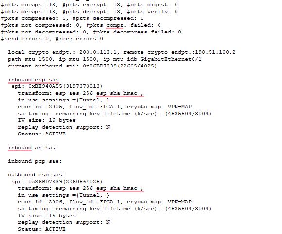
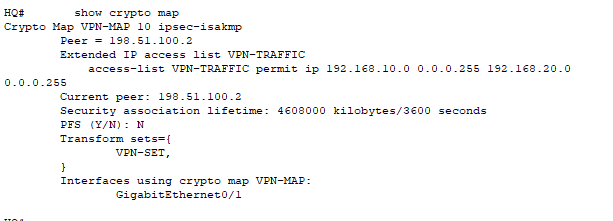

# Projet 3: VPN site-à-site IPsec (HQ - BRANCH)

## Objectif
Relier deux sites distants (siège et succursale) à travers un réseau
« Internet » (routeur ISP) avec un tunnel VPN IPsec, afin que les LANs
privés communiquent de façon chiffrée. Projet réalisé avec Cisco Packet Tracer.

## Topologie

## Plan d'adressage

### LANs
| Site   | Réseau          | Passerelle   | PC                 |
|--------|-----------------|--------------|--------------------|
| HQ     | 192.168.10.0/24 | 192.168.10.1 | PC1: 192.168.10.10 |
| BRANCH | 192.168.20.0/24 | 192.168.20.1 | PC2: 192.168.20.10 |

### Liens vers « Internet » (/30)
| Lien         | Réseau          | Adresses                                          |
|--------------|-----------------|---------------------------------------------------|
| HQ - ISP     | 203.0.113.0/30  | HQ Gig0/1: .1, ISP Gig0/0: .2                     |
| ISP - BRANCH | 198.51.100.0/30 | ISP Gig0/1: .1, BRANCH Gig0/1: .2                 |

HQ et BRANCH ont une route par défaut vers l'ISP. L'ISP ne connaît
volontairement aucune route vers les réseaux privés 192.168.x.x.

## Paramètres du VPN
| Élément            | Valeur                                   |
|--------------------|------------------------------------------|
| Phase 1 (ISAKMP)   | AES-256, SHA, clé pré-partagée, DH groupe 2 |
| Phase 2 (IPsec)    | esp-aes 256 + esp-sha-hmac, mode tunnel  |
| Trafic protégé     | 192.168.10.0/24 <-> 192.168.20.0/24 (ACL VPN-TRAFFIC) |
| Application        | crypto map VPN-MAP sur Gig0/1 de HQ et BRANCH |

La clé partagée du dépôt est une clé de laboratoire. Ne jamais publier
une clé réelle.

## Configurations
- [HQ-config.txt](configs/HQ-config.txt)
- [ISP-config.txt](configs/ISP-config.txt)
- [BRANCH-config.txt](configs/BRANCH-config.txt)

## Tests et résultats

### 1. Sans VPN
Le ping de PC1 vers PC2 échoue: l'ISP ne sait pas router les adresses privées.

### 2. Avec VPN
Le tunnel est actif, le ping réussit (4/4). Le TTL de 126 montre que
seuls HQ et BRANCH décrémentent le TTL: l'ISP ne voit qu'un paquet encapsulé.

### 3. Phase 1 (ISAKMP)
État `QM_IDLE` / `ACTIVE`.

### 4. Phase 2 (IPsec)
Les compteurs `encaps` et `decaps` augmentent avec le trafic, sans erreur.

### 5. Crypto map

## Problèmes rencontrés et solutions

1. Mauvais type de câble
   - Cause: câbles croisés utilisés entre routeur et switch.
   - Solution: câbles droits pour routeur-switch, croisés pour routeur-routeur.

2. Commande refusée (`Invalid input`)
   - Cause: un `exit` en trop après le transform-set a fait sortir du mode
     configuration, la commande `ip access-list` a été saisie en mode `HQ#`.
   - Solution: refaire `configure terminal`, puis saisir l'ACL et la crypto map.

3. Commandes `show crypto` refusées
   - Cause: saisies dans le Command Prompt du PC au lieu de la CLI du routeur.
   - Solution: utiliser la CLI de HQ.

4. Premier ping en échec après activation
   - Cause: négociation du tunnel en cours.
   - Solution: relancer le ping; le tunnel s'établit puis le trafic passe.

## Améliorations possibles
- Ajouter un NAT sur HQ et BRANCH avec exemption du trafic VPN
- Tunnel GRE over IPsec ou VPN avec routage dynamique (OSPF)
- Clé plus robuste et paramètres IKEv2